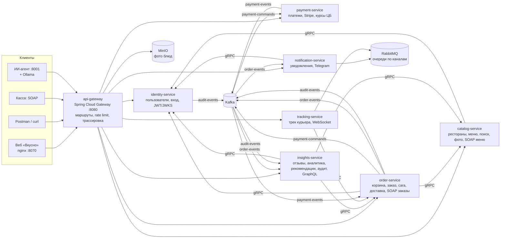
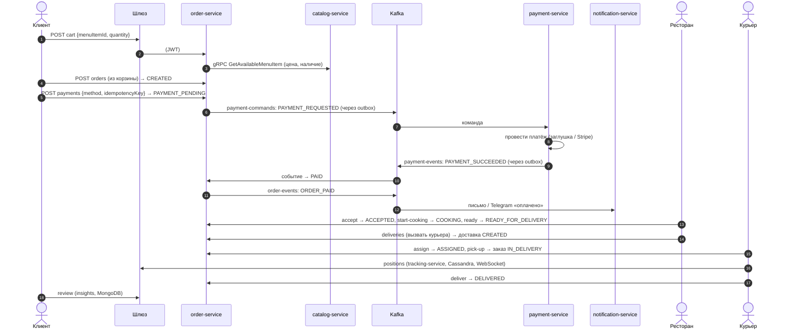
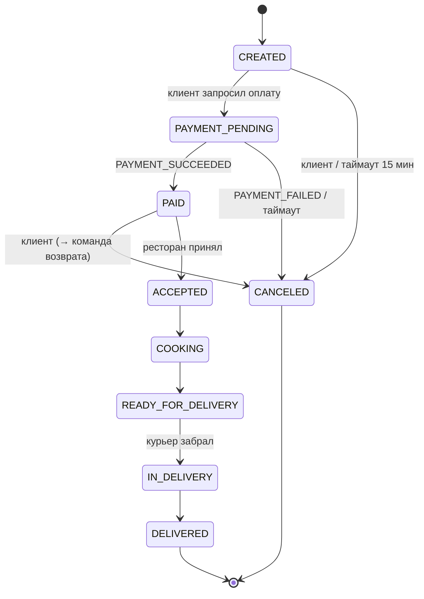
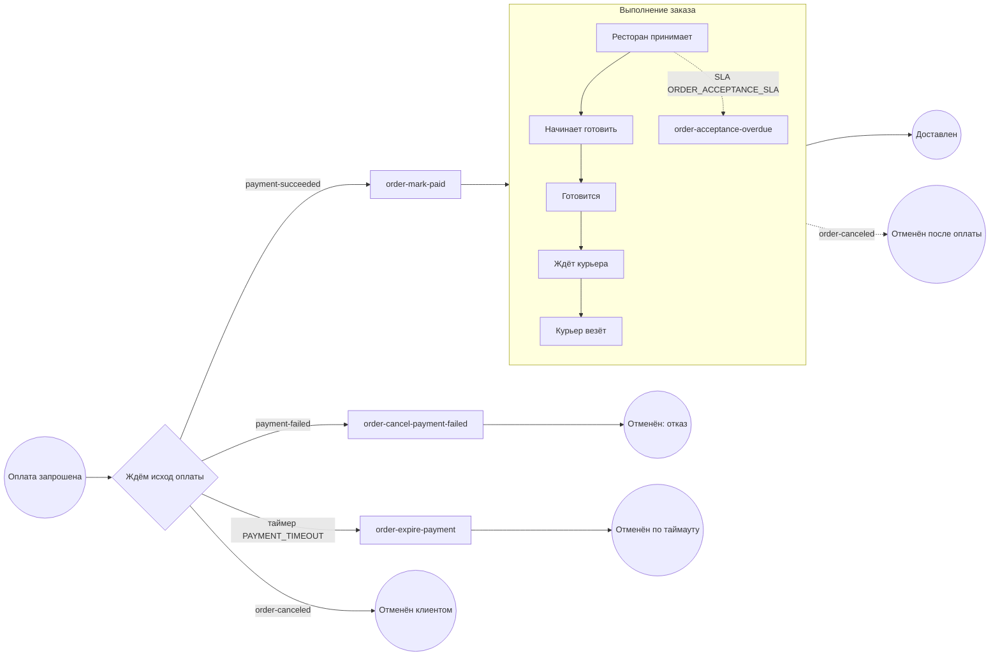

# Food Delivery Platform («Вкусно») — полное описание проекта для разбора

Документ для системного аналитика: что это за система, из чего она состоит, **почему** она устроена именно так,
как её проверить руками разными клиентами (не только через веб-интерфейс) и где в коде искать подтверждение
каждого утверждения. Его можно целиком отдать ChatGPT как контекст и разбирать по разделам (см. раздел 13).

> Соглашения. Пути вида `order-service: order/saga/PaymentSaga.java` означают файл
> `src/main/java/com/dima/fooddelivery/order/saga/PaymentSaga.java` в репозитории `food-delivery-order-service`.
> Все адреса — для локального запуска (`./scripts/start.ps1`). Пароли и ключи лежат в `.env` (в Git его нет).

---

## Содержание

1. [Что это и для кого](#1-что-это-и-для-кого)
2. [Архитектура одним взглядом](#2-архитектура-одним-взглядом)
3. [Репозитории, контракты и поставка](#3-репозитории-контракты-и-поставка)
4. [Сервисы по отдельности](#4-сервисы-по-отдельности)
5. [Ключевые бизнес-процессы](#5-ключевые-бизнес-процессы)
6. [Сквозные механизмы и почему они такие](#6-сквозные-механизмы-и-почему-они-такие)
7. [Данные: где что хранится](#7-данные-где-что-хранится)
8. [Интеграции](#8-интеграции)
9. [Наблюдаемость](#9-наблюдаемость)
10. [Запуск, режимы, память, копии](#10-запуск-режимы-память-копии)
11. [Ручная проверка разными клиентами](#11-ручная-проверка-разными-клиентами)
12. [Известные ограничения и долги](#12-известные-ограничения-и-долги)
13. [Как разбирать проект с ChatGPT](#13-как-разбирать-проект-с-chatgpt)
14. [Глоссарий](#14-глоссарий)

---

## 1. Что это и для кого

Платформа доставки еды: клиент выбирает ресторан, собирает корзину, оплачивает заказ, ресторан готовит,
курьер везёт, клиент видит курьера на карте и оставляет отзыв. Вокруг — уведомления (почта, Telegram),
аналитика для ресторана, рекомендации, поиск, сводный журнал аудита, партнёрский SOAP API для касс
ресторанов и ИИ-помощник поддержки.

**Роли** (хранятся в identity-service, попадают в токен):

| Роль | Что делает | Как получить |
|---|---|---|
| `CUSTOMER` | заказывает, платит, отслеживает, оставляет отзыв | самостоятельная регистрация |
| `RESTAURANT_OWNER` | ведёт рестораны: меню, приём заказов, аналитика | регистрация; управляющим ресторана становится его создатель |
| `COURIER` | берёт доставки, отправляет координаты, завершает | регистрация |
| `ADMIN` | пользователи и роли, журнал аудита, аналитика платформы, служебные операции | **только** администратор платформы (первый — из `.env`) |

У одного пользователя может быть несколько ролей. Право на конкретный ресторан — отдельная связь
«пользователь ↔ ресторан» (`restaurant_manager`), а не роль.

**Каналы доступа к системе** (их и стоит «протыкать»):

| Клиент | Протокол | Через что |
|---|---|---|
| Веб-интерфейс «Вкусно» | REST (JSON) | nginx → шлюз |
| Postman / curl / PowerShell | REST | шлюз `:8080` |
| Swagger UI, GraphiQL | REST / GraphQL | шлюз |
| Касса ресторана | SOAP 1.1 | шлюз `/ws/menu`, `/ws/orders` |
| Браузер с картой | WebSocket + STOMP | шлюз `/ws/tracking` |
| ИИ-помощник | REST | агент `:8001` (или `/agent/` через nginx) |
| Telegram | Bot API (long polling) | notification-service |
| Сервисы между собой | gRPC с mTLS, Kafka, RabbitMQ | внутренняя сеть Docker |

---

## 2. Архитектура одним взглядом



**Принципы, на которых всё держится**

1. **Database per service.** У каждого сервиса своя база и своя учётная запись PostgreSQL; в чужие таблицы
   никто не ходит. Нужны чужие данные — gRPC-запрос владельцу или событие в Kafka.
2. **Синхронно — gRPC, асинхронно — Kafka.** gRPC там, где ответ нужен «здесь и сейчас» (цена блюда при
   добавлении в корзину, права на ресторан). Kafka там, где одно действие должно вызвать реакцию других
   сервисов, и они не должны знать друг о друге (заказ оплачен → письмо, аналитика, журнал).
3. **Надёжная доставка событий: outbox + inbox.** Событие пишется в ту же транзакцию, что и бизнес-изменение,
   и публикуется отдельно. Потребитель отбрасывает повторы по `eventId`. Итог — «хотя бы один раз» плюс
   идемпотентность вместо недостижимого «ровно один раз».
4. **Сага вместо распределённой транзакции.** Оплата заказа — обмен командами и событиями между order и
   payment с компенсацией (возвратом), а не 2PC.
5. **Каждый сервис сам проверяет токен.** Шлюз — не единственная линия защиты: до сервиса можно достучаться
   в обход шлюза, поэтому каждый — resource server с проверкой подписи по JWKS.
6. **Производные хранилища можно пересобрать.** Поиск (Elasticsearch), граф рекомендаций (Neo4j), витрина
   аналитики (ClickHouse) строятся из основной базы и событий; их потеря не теряет данные.

---

## 3. Репозитории, контракты и поставка

| Репозиторий | Что внутри |
|---|---|
| `food-delivery-platform` | Docker Compose, наблюдаемость, Postman, веб-интерфейс `web/`, скрипты `scripts/`, документация |
| `food-delivery-contracts` | общие контракты, версия своя (сейчас 1.3.x) |
| `food-delivery-api-gateway` | шлюз |
| `food-delivery-identity-service`, `-catalog-`, `-order-`, `-payment-`, `-notification-`, `-tracking-`, `-insights-service` | сервисы |
| `food_delivery_agent` | ИИ-помощник на Python (FastAPI) |

**Контракты** (`food-delivery-contracts`, публикуются в GitHub Packages по тегу `vX.Y.Z`):

- `libs/event-contracts` — Java-записи сообщений Kafka и имена топиков. **Без зависимостей** — иначе контракт
  навязывал бы всем сервисам версии библиотек.
- `libs/grpc-contracts` — `.proto` и сгенерированные стабы: `catalog.v1.CatalogService`,
  `identity.v1.RestaurantAccessService`, `identity.v1.UserDirectoryService`, `order.v1.OrderQueryService`.
- `libs/soap-contracts` — XSD партнёрского SOAP API (`urn:fooddelivery:partner:v1`) и JAXB-классы.
- `client` + `openapi/food-delivery-api.yaml` — OpenAPI каталога; из него генерируются контроллеры каталога
  (API-first) и Java-клиент.

*Почему отдельный репозиторий.* Контракт меняется по своим правилам: совместимое изменение (новое поле,
метод) — минорная версия; несовместимое — новая мажорная версия и новый пакет (`catalog.v2`), старый живёт
рядом. Сервисы обновляются на новую версию независимо.

**Поставка.** CI каждого репозитория прогоняет unit- и интеграционные тесты (Testcontainers: настоящие
PostgreSQL, Kafka, Redis, MinIO) и собирает образ `ghcr.io/dima77726/food-delivery-<service>:main`.
Compose платформы не собирает код — он тянет готовые образы (`<SERVICE>_TAG` в `.env` фиксирует версию).

---

## 4. Сервисы по отдельности

Для каждого: ответственность → API → данные → связи → ключевые решения.

### 4.1 api-gateway (Spring Cloud Gateway, WebFlux)

- **Делает:** единая точка входа `:8080`, маршрутизация по путям на сервисы, ограничение частоты запросов
  (Redis, token bucket), сквозной `X-Correlation-Id`, трассировка, проксирование WebSocket и SOAP.
- **Безопасность:** срезает входящий заголовок `X-User-Id` (никто снаружи не может «назваться» пользователем);
  `/media/**` (фото) — только GET/HEAD, заголовки `Authorization` и `Cookie` не пересылаются в MinIO.
- **Rate limit:** общий — 50 запросов/с, всплеск 100; вход и регистрация — запрос стоит 4 токена при
  пополнении 1/с и ёмкости 20 (≈5 попыток подряд, дальше одна в ~4 с). При недоступном Redis — пропускает
  (fail-open: лучше без ограничения, чем лечь целиком).
- **Код:** `src/main/resources/application.yml` (все маршруты с комментариями), `GatewayRoutingIT`.

### 4.2 identity-service

- **Делает:** регистрация, вход, refresh-токены, выпуск JWT (RS256), публикация открытых ключей (JWKS),
  администрирование пользователей и ролей, права на рестораны, вход через Keycloak.
- **REST:** `POST /api/v1/auth/register|login|refresh|logout|oidc`, `GET /api/v1/auth/me`,
  `GET /api/v1/admin/users`, `POST /api/v1/admin/users/{id}/roles/{role}|enable|disable|restaurants/{rid}`,
  `GET /.well-known/jwks.json`.
- **gRPC:** `RestaurantAccessService.CheckRestaurantAccess/AssignRestaurantManager` (каталог, заказы, insights
  спрашивают «управляет ли пользователь рестораном»), `UserDirectoryService.GetUserContact` (почта для писем).
- **Данные (БД `identity`):** `app_user`, `app_user_role`, `restaurant_manager`, `refresh_token`,
  `external_identity`, `audit_log`.
- **Решения:**
  - Access-токен живёт 15 минут, refresh — 30 дней и **одноразовый** (ротация). Повторное предъявление уже
    использованного refresh-токена отзывает всю цепочку — признак кражи.
  - При неизвестной почте пароль всё равно сверяется с «пустым» хешем — время ответа не выдаёт,
    зарегистрирован ли адрес. Сообщение одно: «неверный e-mail или пароль».
  - `ADMIN` при регистрации получить нельзя.
  - Права на ресторан не кладутся в токен: список ресторанов меняется чаще, чем живёт токен.

### 4.3 catalog-service

- **Делает:** рестораны, меню (категории, блюда, наличие, архив), публичная витрина, поиск, фото блюд,
  SOAP API меню для касс.
- **REST (API-first, из OpenAPI):** `GET /api/v1/restaurants`, `/{id}`, `/{id}/menu` (публичные),
  `POST /api/v1/restaurants`, `PATCH`, `/open`, `/close`, управление меню `/{id}/menu/manage|categories|items`,
  `PUT/DELETE /{id}/menu/items/{itemId}/image`, `GET /api/v1/search?q=&city=`.
- **SOAP:** `POST /ws/menu` (`GetMenu`, `SetItemAvailability`), WSDL `GET /ws/menu.wsdl`.
- **gRPC (сервер):** `CatalogService.GetActiveRestaurant/GetAvailableMenuItem/GetRestaurant` — заказы спрашивают
  цену и доступность блюда при добавлении в корзину.
- **Данные:** PostgreSQL `catalog`; Redis — кэш публичного меню (10 мин) и списка ресторанов (5 мин), сбрасывается
  при любом изменении меню; Elasticsearch — поисковый индекс; MinIO — фото.
- **Решения:**
  - Кэшируется только **публичное** меню: владелец после «Сохранить» должен видеть результат сразу.
  - Удаление блюда — архивирование (заказы прошлого ссылаются на блюдо).
  - Фото: тип определяется по первым байтам, а не по имени/заголовку (HTML под видом `.png` → 415); лимит 2 МБ
    (413); ключ `menu-items/{id}/{uuid}.{ext}` — новый на каждую загрузку, старый удаляется **после** фиксации
    транзакции, новый удаляется при откате. Нет общей транзакции между S3 и БД — порядок выбран так, чтобы
    сбой оставлял лишний файл, а не ссылку в пустоту.

### 4.4 order-service

- **Делает:** корзина (по одной на ресторан), заказ, жизненный цикл статусов, сага оплаты, доставка
  (назначение курьера, «забрал», «доставил»), SOAP API заказов для касс.
- **REST:** корзина `/api/v1/customers/{cid}/restaurants/{rid}/cart[/items/{id}]`,
  заказы клиента `/api/v1/customers/{cid}/orders[/{id}][/events|/cancel|/payments]`, лента с курсором `/feed`,
  заказы ресторана `/api/v1/restaurants/{rid}/orders[?status=]`, `/accept`, `/start-cooking`,
  `/ready-for-delivery`, `/deliveries`; курьер `/api/v1/deliveries/available`,
  `/api/v1/couriers/{id}/deliveries[/{did}/assign|pick-up|deliver]`.
- **SOAP:** `POST /ws/orders` (`ListOpenOrders`, `GetOrderStatus`, `AcceptOrder`).
- **gRPC:** клиент `CatalogService` и `RestaurantAccessService`; сервер `OrderQueryService` (для insights и tracking).
- **Kafka:** публикует `order-events`, `payment-commands`, `audit-events`; читает `payment-events`.
- **Данные (БД `orders`):** корзины, `customer_order`, позиции, `customer_order_event` (хронология),
  доставки, `order_event_outbox`, inbox платёжных событий, `audit_log`.
- **Решения:**
  - Цена фиксируется в корзине/заказе из каталога по gRPC: клиент не может прислать свою цену.
  - Две корзины одного клиента в разных ресторанах — нормально; заказ создаётся из корзины, корзина
    закрывается compare-and-set (двойной клик не создаст два заказа).
  - Списки заказов — постранично (`page/size`, есть счётчик) **и** курсором (`/feed`, не сбивается при новых
    заказах, стоит одинаково на любой глубине).
  - Переходы статусов — явный конечный автомат (`order/domain/OrderStatus.java`), см. 5.2.

### 4.5 payment-service

- **Делает:** проводит платежи по командам из Kafka, хранит платежи, публикует итог; возвраты.
- **REST:** `GET /api/v1/customers/{cid}/orders/{oid}/payments`, `GET /api/v1/customers/{cid}/payments`
  (POST на тот же адрес принадлежит order-service — его различает метод запроса).
- **Платёжный шлюз:** `PAYMENT_GATEWAY=simulated` (по умолчанию; сумма с копейками `.13` — отказ банка) или
  `stripe` (настоящий Stripe в тестовом режиме, PaymentIntent + Refund, `Idempotency-Key`).
- **Пересчёт валюты:** `FX_ENABLED=true` — рублёвая сумма пересчитывается по курсу ЦБ РФ (SOAP-клиент к
  `DailyInfo.GetCursOnDateXML`), см. 8.3.
- **Данные (БД `payments`):** `payment` (с `provider_reference`), `payment_outbox`, inbox команд.
- **Решения:** отказ банка (HTTP 402) — это **результат** (платёж FAILED с причиной); всё остальное (сеть,
  5xx, таймаут, нет курса) — **исключение**: транзакция откатывается, команда повторяется, после попыток — DLT.
  Иначе клиенту отказали бы из-за чужого сбоя.

### 4.6 notification-service

- **Делает:** превращает события заказов в уведомления и доставляет их по каналам: EMAIL (настоящие письма
  через SMTP, локально — Mailpit), TELEGRAM (бот), SMS и PUSH — пока «в журнал».
- **REST:** `GET /api/v1/notifications/me`, `POST /api/v1/notifications/telegram/link`.
- **Kafka:** читает `order-events` (группа `food-delivery-notifications`).
- **RabbitMQ:** exchange `notifications.dispatch` → очереди `notifications.email|sms|push|telegram`;
  повторы через `notifications.retry` (очереди с TTL), окончательные отказы — `notifications.dead`.
- **gRPC:** клиент `UserDirectoryService` (в событии заказа нет почты — это персональные данные; её спрашивают у
  владельца), с предохранителем (Resilience4j) и прогревом канала при старте.
- **Решения:**
  - *Зачем RabbitMQ, если есть Kafka?* Kafka — журнал событий для многих читателей. Для рассылки нужны
    очереди задач по каналам с отложенными повторами и DLQ на уровне отдельного сообщения — это сильная
    сторона RabbitMQ. «Медленный» канал не тормозит остальные.
  - Отказы делятся на временные (повторить позже) и постоянные (`PermanentDeliveryException`: адреса нет,
    пользователь отписался) — постоянные не повторяются.
  - Telegram: привязка по одноразовому коду в ссылке `t.me/<бот>?start=<код>` (код хранится хешем), бот читает
    обновления long polling, смещение хранится в БД, токен бота не попадает в журналы и трассы.

### 4.7 tracking-service

- **Делает:** принимает координаты курьера, хранит трек, отдаёт его клиенту, транслирует вживую.
- **REST:** `POST /api/v1/couriers/{id}/deliveries/{did}/positions` (только в статусе доставки `PICKED_UP`),
  `GET .../track`, `GET /api/v1/customers/{cid}/orders/{oid}/track`.
- **WebSocket:** `/ws/tracking`, STOMP, подписка `/topic/order.{id}.track`; рассылку делает STOMP-плагин
  RabbitMQ (чтобы несколько экземпляров сервиса видели одни подписки).
- **Данные:** Cassandra — запись частая, чтение по ключу «доставка + время»: классический временной ряд.
- **gRPC:** клиент `OrderQueryService.GetDelivery` (чья доставка, какой статус).

### 4.8 insights-service

- **Делает:** отзывы (MongoDB), аналитика продаж и воронка (ClickHouse), рекомендации «с этим заказывают»
  (Neo4j), **сводный журнал аудита всех сервисов** (ClickHouse), GraphQL поверх всего этого.
- **REST:** отзывы `/api/v1/customers/{cid}/orders/{oid}/review`, `/api/v1/restaurants/{id}/reviews[/summary]`;
  аналитика `/api/v1/restaurants/{id}/analytics/sales|funnel`, `/api/v1/admin/analytics/sales`;
  рекомендации `/api/v1/customers/{cid}/recommendations`, `/api/v1/menu-items/{id}/ordered-together`;
  аудит `/api/v1/admin/audit`; служебное `/api/v1/admin/recommendations/project|rebuild`.
- **GraphQL:** `/graphql`, песочница `/graphiql`: `restaurant(id){rating reviews popularDishes sales}`,
  `dish(id){orderedTogether}`, `myRecommendations`.
- **Kafka:** читает `order-events` (аналитика), `audit-events` (сводный журнал).
- **Решения:** у каждой задачи своё хранилище «по форме данных» (см. 7). Поля из других хранилищ в GraphQL
  сделаны nullable: отказ одного хранилища не обнуляет весь ответ.

### 4.9 ИИ-агент (food_delivery_agent, Python)

- **Делает:** отвечает клиенту о его заказах на естественном языке. Только чтение: отменять и возвращать
  деньги не умеет и честно об этом говорит.
- **API:** `POST /api/v1/chat` (`message`, `conversation_id`), `GET /api/v1/orders/{id}`, `GET /health`.
- **Модель:** локальная Ollama `qwen3:4b-instruct-2507-q4_K_M` на видеокарте (RTX 3060); есть режимы `demo`
  (детерминированный симулятор) и `openai`.
- **Интеграция:** `AUTH_MODE=jwt` — агент проверяет **токен платформы** (RS256 по JWKS, издатель, роль
  `CUSTOMER`) и берёт `customer_id` из `sub`; `ORDERS_BACKEND=platform` — пересылает **тот же токен** в REST
  платформы. У агента нет собственной привилегированной учётной записи: он видит ровно то, что видит клиент.
  Пересылаются `X-Correlation-Id` и `traceparent` — трасса продолжается в платформе.
- **Ограждения:** модель вызывает инструменты (`get_order`, `get_support_policy`), но ответ проходит проверки на
  стороне Python (номер заказа должен быть подтверждён инструментом, при известных ошибках ответ формирует
  сервер, а не модель — поле `answer_source`).

### 4.10 Веб-интерфейс «Вкусно» (`web/` в платформе)

- Статическое приложение на ES-модулях **без сборки и внешних зависимостей**; nginx отдаёт его на `:8070` и
  проксирует `/api`, `/media`, `/ws`, `/.well-known`, `/graphql` на шлюз, `/agent/` — на агента на хосте.
  Один адрес — нет CORS.
- Сессии нескольких аккаунтов хранятся в браузере; меню аккаунта переключает аккаунты и роли без повторного входа.
  Обновление токена — одно на все вкладки (Web Locks), потому что refresh-токен одноразовый.
- Всё пользовательское содержимое выводится через экранирующий шаблон (`web/js/ui.js: html`) — защита от XSS.
- Живые статусы — опрос раз в 4–6 с (а не WebSocket трека) ради простоты.

---

## 5. Ключевые бизнес-процессы

### 5.1 От корзины до доставки



### 5.2 Конечный автомат заказа



- Клиент может отменить в `CREATED`, `PAYMENT_PENDING`, `PAID`. Отмена из `PAYMENT_PENDING`/`PAID` отправляет
  платёжному сервису `REFUND_REQUESTED`: был ли платёж на самом деле, знает только он.
- Таймаут оплаты (`PAYMENT_TIMEOUT`, по умолчанию 15 минут) проверяется раз в минуту: зависший заказ
  отменяется, при необходимости — с возвратом.
- Каждый переход — запись в хронологию (`/events`), событие `order-events` и запись аудита.

**Статусы доставки:** `CREATED` (ищет курьера) → `ASSIGNED` → `PICKED_UP` → `DELIVERED`.

### 5.3 Сага оплаты: что происходит при сбоях

| Сбой | Поведение | Где в коде |
|---|---|---|
| Kafka недоступна | событие лежит в outbox, публикатор повторяет; после 10 попыток — `FAILED` и алерт | `OutboxPublisher` |
| Команда пришла дважды | inbox отбрасывает повтор по `commandId` | inbox-таблица payment |
| Процесс упал между ответом Stripe и коммитом | команда повторится; Stripe по тому же `Idempotency-Key` вернёт прежний результат | `StripePaymentGateway` |
| Банк отказал | `PAYMENT_FAILED` с причиной → заказ `CANCELED` | `PaymentSaga` |
| Сообщение невозможно обработать | после повторов — в `<топик>-dlt` и алерт | `*DltListener` |
| Оплата «зависла» | таймаут → отмена (+ возврат) | `PaymentTimeoutJob` / `app.saga.*` |

### 5.4 Заказ целиком на Camunda 8 (режим `bpm`)

Сагу оплаты и дальнейший путь заказа может вести оркестратор **Camunda 8**: процесс `order-lifecycle`
(`order-service: src/main/resources/bpmn/order-lifecycle.bpmn`), один экземпляр на заказ, от запроса оплаты
до доставки. Включается `./scripts/start.ps1 -Bpm` (профиль `bpm` + `SAGA_ENGINE=camunda`,
`CAMUNDA_CLIENT_ENABLED=true`). Без флага всё работает как раньше.



- **Оплата — оркестрация.** Процесс решает, что делать с исходом: обработчики заданий
  (`order.saga.camunda.OrderLifecycleWorkers`) вызывают те же compare-and-set переходы из `PaymentSaga`.
  Исходы из Kafka становятся сообщениями (ключ корреляции — `orderId`, `messageId` — `eventId`: повтор
  отбрасывает сам брокер). Таймаут — таймер процесса; `PaymentTimeoutJob` в этом режиме следит только
  за неоплаченными `CREATED`.
- **Дальше — наблюдение.** Статусы меняют ресторан и курьер через API, как и раньше; после коммита каждая
  смена уходит процессу сообщением (`OrderStatusMessageListener`), и он переходит к следующему шагу.
  Ранние сообщения брокер держит час, так что быстрый ресторан не обгонит процесс.
- **SLA принятия.** Непрерывающий таймер на шаге «Ресторан принимает»: через `ORDER_ACCEPTANCE_SLA`
  (10 мин) — задание-эскалация и метрика `orders.acceptance.overdue`, заказ продолжает ждать.
- **Что осталось прежним.** Команда «спиши» пишется в outbox в той же транзакции, что и переход в
  `PAYMENT_PENDING`; экземпляр процесса создаётся там же (Camunda недоступна → запрос оплаты откатывается).
- **Где смотреть.** Operate — http://localhost:8091/operate (demo/demo). Заказ в работе — активный экземпляр
  на текущем шаге; завершённые — в фильтре **Finished Instances**. Там же переменные и инциденты, если
  задание упало трижды. REST API — `POST http://localhost:8091/v2/process-instances/search`.
- **Память.** Один контейнер `camunda/camunda` (Zeebe + Operate + Tasklist) с хранилищем H2, без
  Elasticsearch: ~620 МБ при лимите 1 ГБ.

---

## 6. Сквозные механизмы и почему они такие

### 6.1 Аутентификация и авторизация

- **JWT RS256 + JWKS.** Подписывает только identity-service закрытым ключом; остальные проверяют подпись
  открытым ключом из `/.well-known/jwks.json` (кэшируют, перечитывают при незнакомом `kid` — смена ключа без
  перезапуска). *Почему не общий секрет (HS256):* утечка секрета из любого сервиса позволила бы выпускать токены.
- **Состав токена:** `sub` (числовой id), `roles`, `email`, `iss=food-delivery-platform`, `exp`.
- **Права:** роль — `@PreAuthorize("hasRole(...)")`; владение ресторан — `@access.managesRestaurant(#id)`
  (gRPC в identity); «это мой заказ» — путь с `customerId` + `@access.isSelf(#customerId)` и проверка владельца
  в сервисе. Чужой заказ — 403 (идентификаторы последовательные, скрывать существование бессмысленно).
- **Keycloak (профиль `auth`)** опознаёт человека (форма входа, подтверждение почты, защита от перебора).
  `POST /api/v1/auth/oidc` меняет его токен на токен платформы. Проверяются подпись, издатель, клиент (`azp`)
  и **подтверждённая почта**. Привязка — по паре (издатель, subject), затем по почте. Роли из Keycloak — только
  при создании и только `CUSTOMER/RESTAURANT_OWNER/COURIER`; к администратору привязать нельзя.
  *Почему обмен, а не замена:* остальные сервисы не пришлось менять; владельцем пользователей и ролей
  осталась платформа.

### 6.2 Межсервисный gRPC

- **mTLS:** контейнер `grpc-certs` выпускает CA и сертификат каждому сервису (CN = имя сервиса); сервер
  пускает только клиентов из списка `allowed-clients`. *Почему:* внутренняя сеть — не доверенная зона.
- **Дедлайны обязательны** (зависший сосед не держит поток и соединение с БД).
- **Предохранитель (Resilience4j)** как глобальный перехватчик клиента: при серии отказов соседа сразу
  отвечает `UNAVAILABLE` → сервис отдаёт клиенту 503, а не 403/500.
- **Метка запроса** (`X-Correlation-Id`) и трасса передаются в метаданных вызова.

### 6.3 Outbox, inbox и порядок событий

- Событие и бизнес-изменение — в одной транзакции (`*_outbox`), публикатор раз в 2 с отправляет пачку
  (`FOR UPDATE SKIP LOCKED` — несколько экземпляров не мешают друг другу), синхронно ждёт подтверждения брокера.
- Ключ сообщения — id заказа: события одного заказа попадают в одну партицию и приходят по порядку.
- В строке outbox хранится `traceparent`: публикация продолжает трассу исходного запроса — в Tempo видна одна
  цепочка «шлюз → заказ → Kafka → платёж → Kafka → заказ → уведомления → RabbitMQ → gRPC».

### 6.4 Сводный журнал аудита

- Каждый сервис пишет аудит в свою таблицу `audit_log` (в транзакции действия), а она же служит outbox:
  записи уезжают в Kafka `audit-events` и собираются insights-service в ClickHouse.
- `eventId` детерминированный (из сервиса и номера записи), таблица ClickHouse — `ReplacingMergeTree`, чтение с
  `FINAL`: повторная доставка не даёт дублей.
- *Почему не писать сразу в общий журнал:* недоступность общего хранилища не должна мешать действию; запись
  аудита не теряется, если действие состоялось.

### 6.4.1 Журнал аудита, заверенный в блокчейне (профиль `chain`)

Журнал `audit_log` order-service лежит в PostgreSQL, и тот, у кого есть доступ к базе, может поправить запись
задним числом без следов. Против этого — **якорь в блокчейне** (`order-service: ledger/`, включается
`./scripts/start.ps1 -Chain`, по умолчанию выключен):

1. Раз в 5 минут (`AuditAnchorJob`, ShedLock) сервис берёт новые записи журнала старше 30 с (id выдаётся до
   коммита — соседняя запись с меньшим id может закоммититься позже), строит **Merkle-дерево** SHA-256 по
   неизменяемым колонкам (лист `H(0x00‖запись)`, узел `H(0x01‖левый‖правый)`, как в RFC 6962) и пишет корень
   с диапазоном id в смарт-контракт **`AuditAnchor`** (`src/main/solidity/AuditAnchor.sol`) на локальной сети
   Ethereum — **Anvil** из Foundry. В цепочку уходит 32 байта на пачку, персональные данные остаются в базе.
2. Контракт принимает пачки только подряд и только от счёта, который его развернул; переписать корень
   нельзя ни сервису, ни администратору базы.
3. **Проверка** `GET /api/v1/admin/audit-anchors/{id}/verification` заново считает корень из базы и сравнивает с
   корнем в контракте (`eth_call`): `VALID`, `TAMPERED` или `CHAIN_UNAVAILABLE`. Корню из таблицы
   `audit_anchor` не доверяет — его можно поправить вместе с журналом.

Почему без web3j: узел подписывает транзакции сам (`eth_sendTransaction` от разблокированного тестового
счёта Anvil), а ABI трёх функций кодируется вручную — весь клиент JSON-RPC меньше сотни строк. Для публичной
сети понадобилась бы подпись ключом сервиса на своей стороне. Сбой между транзакцией и записью в таблицу
не теряет якорь: перед каждой пачкой сервис сверяет число якорей в контракте и в таблице.

```powershell
# администратор (admin@demo.local): список, внеочередное заверение, проверка
Invoke-RestMethod "$base/api/v1/admin/audit-anchors" -Headers $h
Invoke-RestMethod -Method Post "$base/api/v1/admin/audit-anchors/run" -Headers $h
Invoke-RestMethod "$base/api/v1/admin/audit-anchors/1/verification" -Headers $h        # VALID
# подделать запись прямо в базе и проверить снова — TAMPERED
docker exec food-delivery-postgres psql -U <POSTGRES_USER> -d orders -c "update audit_log set details='x' where id=1"
```

### 6.5 Защита от повторов и гонок

- Оплата: обязательный `idempotencyKey` от клиента (генерируется один раз на экране оплаты).
- Корзина → заказ: compare-and-set статуса корзины.
- Уникальности (почта, имя активной категории/блюда) держит база, а не предварительный SELECT.
- Вход/регистрация ограничены по частоте (429).

---

## 7. Данные: где что хранится

| Хранилище | Кто | Что | Почему именно оно |
|---|---|---|---|
| PostgreSQL | все основные | пользователи, каталог, заказы, платежи, уведомления, outbox/inbox, аудит | транзакции, ограничения целостности |
| Redis | catalog, gateway | кэш меню; корзины токенов rate limit | быстро, TTL, общий для экземпляров |
| Kafka | order, payment, identity → notification, insights | события и команды | журнал с повторным чтением, порядок по ключу, много читателей |
| RabbitMQ | notification, tracking | очереди уведомлений, STOMP-рассылка трека | очереди задач, отложенные повторы, DLQ, STOMP |
| MongoDB | insights | отзывы | документ с вложенными оценками блюд и метками |
| Cassandra | tracking | трек курьера | частые записи временного ряда |
| Neo4j | insights | граф «клиент–заказ–блюдо» | запросы по связям: «с этим заказывают» |
| ClickHouse | insights | аналитика продаж, сводный аудит | колоночная OLAP-агрегация |
| Elasticsearch | catalog | поиск ресторанов и блюд | полнотекстовый поиск с морфологией |
| MinIO (S3) | catalog | фото блюд | объекты; в БД — только ключ |

Базы PostgreSQL: `identity`, `catalog`, `orders`, `payments`, `notification` (+ `food_delivery` — наследие
монолита). Точная схема — в миграциях Liquibase каждого сервиса: `src/main/resources/db/changelog/`.

---

## 8. Интеграции

### 8.1 Почта и Telegram
Почта — SMTP (локально Mailpit, `http://localhost:8025`: все письма видны в веб-интерфейсе, наружу ничего не
уходит). Telegram — бот через Bot API, `TELEGRAM_ENABLED`, `TELEGRAM_BOT_TOKEN`, `TELEGRAM_BOT_USERNAME`.

### 8.2 Платёжный провайдер Stripe
`PAYMENT_GATEWAY=stripe` + `STRIPE_API_KEY=sk_test_…`. Карту клиента сервис не видит (в команде оплаты её нет),
платёж подтверждается тестовым способом оплаты Stripe. Для боевой оплаты нужен Stripe Elements на клиенте —
это изменение контракта команды. Сейчас ключ не подключён: работает заглушка.

### 8.3 Курсы ЦБ РФ (SOAP-клиент)
`payment-service: payment/fx/*`. Курс кэшируется на 6 ч (ЦБ публикует раз в сутки), при недоступности ЦБ
используется курс не старше 72 ч, дальше — отказ с повтором команды. Сумма округляется вверх до цента; рублёвая
сумма, курс и дата пишутся в метаданные платежа Stripe. Возврат — полный, без суммы: пересчёт по новому курсу
разошёлся бы со списанием.

### 8.4 Партнёрский SOAP API (сервер)
Contract-first: XSD → JAXB-классы → WSDL строится Spring WS. Схема разделена на общую часть, меню и заказы,
чтобы WSDL каталога не рекламировал операции заказов. Вход и проверка запроса и ответа по схеме; ошибки —
SOAP Fault с деталью `PartnerFault {code, message, correlationId}`; `Client` — ошибка клиента, `Server` — наша.

### 8.5 MinIO
Бакет `menu-images` с политикой «анонимное чтение объектов» (только `s3:GetObject`), создаётся сервисом.
Адрес в меню — `/media/<ключ>`, шлюз проксирует его в бакет. Официальные образы `minio/minio` сняты с публикации —
используется сборка Chainguard.

### 8.6 Keycloak и ИИ-агент — см. 6.1 и 4.9.

---

## 9. Наблюдаемость

| Что | Где | Зачем |
|---|---|---|
| Метрики | Prometheus `:9090`, Grafana `:3000` (дашборд `food-delivery`) | HTTP, JVM, outbox, платежи, предохранители |
| Трассы | Tempo (через Grafana → Explore → Tempo) | путь запроса через сервисы и брокеры |
| Логи | Loki + Alloy (Grafana → Explore → Loki) | поиск по `traceId`/`correlationId` |
| Алерты | Grafana, 9 правил, письмо в Mailpit | outbox-failed, outbox-backlog, audit-backlog, http-5xx, payments-failed, jvm-heap, service-down, dlt, circuit-open |
| Метка запроса | заголовок `X-Correlation-Id`, MDC в каждой строке журнала | связать запрос, события и журналы |

Формат строки журнала: `[сервис,traceId,spanId,correlationId,userId]`.

---

## 10. Запуск, режимы, память, копии

| Команда | Что |
|---|---|
| `./scripts/start.ps1` | всё (~7 ГБ памяти в Docker) |
| `./scripts/start.ps1 -Light` | без Mongo/Neo4j/ClickHouse/Elasticsearch (~5 ГБ): нет отзывов, рекомендаций, аналитики, поиска |
| `-Agent` | + Ollama и агент на хосте (модель на видеокарте) |
| `-Auth` | + Keycloak (~0,7 ГБ) |
| `./scripts/stop.ps1` | остановить, данные сохраняются |
| `./scripts/backup.ps1` / `restore.ps1` | копия PostgreSQL, фото, Keycloak, отзывов, `.env` / восстановление |
| `python scripts/seed-demo.py` | демо-пользователи и рестораны |

Профили Compose: `full` (сервисы, наблюдаемость, веб, MinIO, Mailpit), `stores` (Mongo, Neo4j, ClickHouse,
Elasticsearch; Cassandra нужна и в `full`), `auth` (Keycloak), `tools` (Kafka UI). Ноутбук 16 ГБ: Docker/WSL
ограничен 9 ГБ + 8 ГБ подкачки (`%UserProfile%\.wslconfig`).

**Адреса:** веб `:8070`, шлюз `:8080`, Grafana `:3000`, Prometheus `:9090`, Mailpit `:8025`, RabbitMQ `:15672`,
Kafka UI `:8090` (профиль tools), MinIO-консоль `:9001`, Keycloak `:8180`, агент `:8001`, PostgreSQL — порт из
`.env` (`POSTGRES_PORT`), Mongo `:27017`, Neo4j `:7474`, ClickHouse `:8123`, Elasticsearch `:9200`.

---

## 11. Ручная проверка разными клиентами

Примеры на PowerShell (в Windows `curl` — это `curl.exe`). Демо-пароль `demo12345`.

### 11.1 Получить токен и узнать себя

```powershell
$base = 'http://localhost:8080'
$login = Invoke-RestMethod -Method Post -Uri "$base/api/v1/auth/login" -ContentType 'application/json' `
  -Body '{"email":"anna@demo.local","password":"demo12345"}'
$h = @{ Authorization = "Bearer $($login.accessToken)" }
$cid = $login.user.id
Invoke-RestMethod "$base/api/v1/auth/me" -Headers $h
```

Что посмотреть: разберите `accessToken` на https://jwt.io (или вручную base64) — `sub`, `roles`, `exp`.

### 11.2 Полный цикл заказа через REST

```powershell
$rest = (Invoke-RestMethod "$base/api/v1/restaurants") | Where-Object name -eq 'Бургерная №7'
$menu = Invoke-RestMethod "$base/api/v1/restaurants/$($rest.id)/menu"
$item = $menu.categories[0].items[0]

# корзина и заказ
Invoke-RestMethod -Method Post "$base/api/v1/customers/$cid/restaurants/$($rest.id)/cart" -Headers $h `
  -ContentType 'application/json' -Body (@{ menuItemId = $item.id; quantity = 2 } | ConvertTo-Json)
$order = Invoke-RestMethod -Method Post "$base/api/v1/customers/$cid/restaurants/$($rest.id)/orders" -Headers $h

# оплата: ключ идемпотентности генерирует клиент
$key = [guid]::NewGuid().ToString()
Invoke-RestMethod -Method Post "$base/api/v1/customers/$cid/orders/$($order.id)/payments" -Headers $h `
  -ContentType 'application/json' -Body (@{ method = 'CARD'; idempotencyKey = $key } | ConvertTo-Json)
Start-Sleep 5
Invoke-RestMethod "$base/api/v1/customers/$cid/orders/$($order.id)" -Headers $h        # status = PAID
Invoke-RestMethod "$base/api/v1/customers/$cid/orders/$($order.id)/events" -Headers $h # хронология
```

Ресторатор (`oleg@demo.local`): `POST /api/v1/restaurants/{rid}/orders/{oid}/accept`, `/start-cooking`,
`/ready-for-delivery`, `/deliveries`. Курьер (`kirill@demo.local`): `GET /api/v1/deliveries/available`,
`POST /api/v1/couriers/{kid}/deliveries/{did}/assign`, `/pick-up`, `positions` с телом
`{"latitude":55.75,"longitude":37.61,"speedKmh":20}`, `/deliver`.

Готовая коллекция со всеми запросами и автотестами: `postman/` в репозитории платформы (импортировать в Postman).

### 11.3 Что проверить в хранилищах после цикла

```powershell
# PostgreSQL: пользователь — POSTGRES_USER из .env
docker exec -it food-delivery-postgres psql -U <POSTGRES_USER> -d orders
#   \dt                                    -- таблицы
#   select id,status from customer_order order by id desc limit 5;
#   select event_type,status,traceparent from order_event_outbox order by id desc limit 10;
#   select action,resource_id,details from audit_log order by id desc limit 10;
docker exec -it food-delivery-postgres psql -U <POSTGRES_USER> -d payments   # payment, payment_outbox
docker exec -it food-delivery-postgres psql -U <POSTGRES_USER> -d identity   # app_user, refresh_token
```

- **Kafka:** `./scripts/start.ps1` не поднимает Kafka UI; запустите `docker compose --profile tools up -d kafka-ui`
  → http://localhost:8090. Топики `food-delivery.order-events`, `.payment-commands`, `.payment-events`,
  `.audit-events` и их `-dlt`. Найдите сообщения своего заказа (ключ = id заказа), посмотрите заголовки
  (`X-Correlation-Id`, `traceparent`).
- **RabbitMQ:** http://localhost:15672 (логин/пароль `RABBITMQ_*` из `.env`) → Exchanges `notifications.*`,
  Queues `notifications.email|telegram|...`, `notifications.dead`.
- **Письма:** http://localhost:8025 — письма «оплачен», «принят», «в пути», «доставлен».
- **ClickHouse:** http://localhost:8123/play — таблицы аналитики и сводного аудита.
- **MongoDB:** `docker exec -it food-delivery-mongo mongosh` → отзывы.
- **Neo4j:** http://localhost:7474 → граф заказов (`MATCH (n) RETURN n LIMIT 50`).
- **Elasticsearch:** `curl.exe "http://localhost:9200/_cat/indices?v"`.
- **MinIO:** http://localhost:9001 (`MINIO_ROOT_*` из `.env`) → бакет `menu-images`.
- **Трасса:** Grafana → Explore → Tempo → найти по сервису `order-service`; или по `traceId` из строки журнала.

### 11.4 Swagger и GraphQL

- Swagger UI insights: http://localhost:8080/swagger-ui.html. У остальных сервисов Swagger на их собственных
  портах внутри сети Docker (снаружи не опубликованы) — для них используйте Postman.
- GraphiQL: http://localhost:8080/graphiql. Пример:

```graphql
{
  restaurant(id: 26) {
    name
    rating { average total }
    reviews(page: 0, size: 5) { items { rating comment } }
    popularDishes(limit: 3) { name score }
  }
}
```

Поле `sales` требует токен ресторатора/админа — без него вернётся `null` с ошибкой только для этого поля.

### 11.5 SOAP (SoapUI, Postman или curl)

WSDL: `http://localhost:8080/ws/menu.wsdl`, `http://localhost:8080/ws/orders.wsdl` — импортируйте в SoapUI.
Запросы требуют заголовок `Authorization: Bearer <токен ресторатора>`.

```powershell
$owner = Invoke-RestMethod -Method Post "$base/api/v1/auth/login" -ContentType 'application/json' `
  -Body '{"email":"oleg@demo.local","password":"demo12345"}'
$body = @"
<soapenv:Envelope xmlns:soapenv="http://schemas.xmlsoap.org/soap/envelope/">
  <soapenv:Body><ListOpenOrdersRequest xmlns="urn:fooddelivery:partner:v1"><restaurantId>26</restaurantId></ListOpenOrdersRequest></soapenv:Body>
</soapenv:Envelope>
"@
Invoke-WebRequest -Method Post "$base/ws/orders" -ContentType 'text/xml; charset=utf-8' `
  -Headers @{ Authorization = "Bearer $($owner.accessToken)" } -Body $body | Select-Object -Expand Content
```

Проверьте: чужой ресторан → Fault `FORBIDDEN`; `restaurantId` = 0 → Fault по схеме; повторный `AcceptOrder` →
`CONFLICT`.

### 11.6 gRPC (grpcurl)

gRPC-порты наружу не опубликованы и защищены mTLS со списком разрешённых клиентов. Проверять можно изнутри
сети Docker сертификатом одного из сервисов-клиентов (например, `order-service`), proto — из
`food-delivery-contracts/libs/grpc-contracts/src/main/proto`:

```powershell
docker network ls          # имя сети compose, обычно food-delivery-platform_default
docker volume ls           # том с сертификатами: ..._food_delivery_grpc_certs
docker run --rm --network food-delivery-platform_default `
  -v food-delivery-platform_food_delivery_grpc_certs:/certs:ro `
  -v C:\Users\dimit\IdeaProjects\food-delivery-contracts\libs\grpc-contracts\src\main\proto:/proto:ro `
  fullstorydev/grpcurl -cacert /certs/ca.crt -cert /certs/order-service.crt -key /certs/order-service.key `
  -import-path /proto -proto fooddelivery/catalog/v1/catalog.proto `
  -d '{"restaurant_id": 26}' catalog-service:9090 fooddelivery.catalog.v1.CatalogService/GetRestaurant
```

(Proto: `fooddelivery/catalog/v1/catalog.proto`, `fooddelivery/identity/v1/restaurant_access.proto`, `fooddelivery/identity/v1/user_directory.proto`, `fooddelivery/order/v1/order_query.proto`. Образ grpcurl скачается при первом запуске.)
Попробуйте сертификат сервиса, которого нет в списке разрешённых, — сервер откажет.

### 11.7 WebSocket трека
STOMP-клиент (например, расширение браузера или `stomp.js` в консоли): подключение к
`ws://localhost:8080/ws/tracking` с токеном клиента, подписка `/topic/order.<id>.track`, затем курьер отправляет
`positions` — точки приходят без опроса.

### 11.8 ИИ-агент напрямую

```powershell
Invoke-RestMethod -Method Post http://127.0.0.1:8001/api/v1/chat -Headers $h `
  -ContentType 'application/json; charset=utf-8' `
  -Body ([Text.Encoding]::UTF8.GetBytes((@{ message = "Где заказ $($order.id)?" } | ConvertTo-Json)))
```

Смотрите `tool_calls` (какие инструменты вызвала модель) и `answer_source` (`agent` — ответ модели,
`server` — сформирован проверенным кодом).

### 11.9 Негативные и пограничные сценарии (обязательно протыкать)

| Сценарий | Ожидание |
|---|---|
| Заказ другого клиента: `GET /customers/{чужой id}/orders/{id}` | 403 |
| Регистрация с `role: ADMIN` | 409, роль не выдаётся |
| 6+ неверных входов подряд | 429 (rate limit) |
| Повтор оплаты с тем же `idempotencyKey` | без второго списания |
| Сумма заказа с копейками `.13` (заглушка) | `PAYMENT_FAILED` → заказ `CANCELED` |
| Отмена оплаченного заказа | `CANCELED` + `REFUND_REQUESTED` → `PAYMENT_REFUNDED` |
| Повторное использование старого refresh-токена | 401 и отзыв всех сессий этой цепочки |
| Заблокировать пользователя (админ) | его refresh-токены отозваны, вход — 403 |
| Остановить identity-service, затем действие ресторатора | 503 (предохранитель), а не 403 |
| Загрузить HTML с именем `.png` как фото | 415; файл больше 2 МБ — 413 |
| Позиция курьера до «забрал» | 409 |
| Принять неоплаченный заказ | 409 (REST и SOAP) |
| Остановить Kafka на минуту, сделать заказ, запустить | outbox доотправит, заказ дойдёт до `PAID` |
| Вход в агента токеном ресторатора | 401: агент только для клиентов |

---

## 12. Известные ограничения и долги

- **Деньги:** платежи — заглушка, пока не задан ключ Stripe; карта клиента не передаётся (нужен Stripe Elements).
- **Нет списка «мои рестораны»** в API: веб-интерфейс определяет их перебором (запрос заказов каждого ресторана),
  результат кэширует на минуту.
- **Опечатка в API:** время события заказа в поле `createAt` (а не `createdAt`); клиенты учитывают обе формы.
- **Доставка без адреса и реальной геолокации**: курьер в интерфейсе «едет» по учебному маршруту.
- **SMS и Push** — только запись в журнал.
- **Один экземпляр всего**, без HTTPS; Keycloak в режиме `start-dev`; токены в браузере — в `localStorage`.
- **Демо-аккаунты** с общим известным паролем — только для локального компьютера.
- **Копия данных** не включает трек (Cassandra) и производные хранилища; восстановление на живых данных не
  прогонялось (копия проверена разворачиванием во временный PostgreSQL).
- **Сознательно не сделано:** Debezium/Schema Registry, Temporal, Kubernetes/Argo CD — платформе не нужны на
  одном компьютере.
- **Проекция рекомендаций** в Neo4j запускается вручную (кнопка у админа / `POST /api/v1/admin/recommendations/*`).

---

## 13. Как разбирать проект с ChatGPT

Отдайте этот файл целиком, затем идите по шагам. Для каждого шага открывайте указанные файлы и вставляйте их
содержимое в чат.

1. **Контекст и границы.** «Нарисуй контекстную диаграмму (C4 L1/L2) по разделам 1–2. Какие границы сервисов
   спорные?»
2. **Модель предметной области.** `order-service: order/domain/OrderStatus.java`, `order/service/OrderService.java`.
   «Проверь конечный автомат заказа. Каких переходов не хватает для реального бизнеса (частичная отмена,
   замена блюда, повторная доставка)?»
3. **Сага оплаты.** `order/saga/PaymentSaga.java`, `PaymentEventsConsumer.java`,
   `payment-service: payment/service/PaymentService.java`, `PaymentCommandsConsumer.java`. «Найди сценарии
   гонок и двойного списания. Чем хореография хуже/лучше оркестрации здесь?»
4. **Outbox/inbox.** `order/service/OutboxPublisher.java`, `order/persistence/OutboxRepository.java`. «Какие
   гарантии даёт эта реализация? Что будет при двух экземплярах сервиса?»
5. **Безопасность.** `identity-service: user/service/AuthService.java`, `RefreshTokenService.java`,
   `common/security/*`; `catalog-service: common/security/ResourceAccessGuard.java`. «Проведи STRIDE-анализ.»
6. **Контракты.** `food-delivery-contracts` (proto, XSD, OpenAPI). «Оцени правила версионирования; что будет,
   если поменять тип поля?»
7. **Нефункциональные требования.** Разделы 6, 9, 10. «Составь список NFR (доступность, задержки, RPO/RTO) и
   проверь, чем они подкреплены.»
8. **Интеграции.** Раздел 8 и код `payment/fx`, `soap/*`, `federation/*`. «Где интеграция хрупкая?»
9. **Тест-план.** Раздел 11. «Сделай чек-лист приёмочного тестирования по ролям и негативным сценариям.»
10. **Требования, восстановленные из кода.** «По REST-эндпоинтам из раздела 4 составь user stories с критериями
    приёмки для каждой роли.»

Полезные артефакты аналитика, которые стоит попросить сгенерировать: глоссарий, диаграммы последовательностей
для каждого процесса, матрица «роль × действие × эндпоинт», карта событий (кто публикует / кто читает), ER-диаграмма
по миграциям каждого сервиса.

---

## 14. Глоссарий

| Термин | Значение |
|---|---|
| Outbox | таблица исходящих событий в той же транзакции, что и изменение; публикуется отдельно |
| Inbox | таблица обработанных входящих сообщений для отсечения повторов |
| Сага | долгий процесс из локальных транзакций разных сервисов с компенсациями вместо общего отката |
| DLT / DLQ | «мёртвый» топик/очередь для сообщений, которые не удалось обработать после повторов |
| Идемпотентность | повтор того же запроса не меняет результат |
| JWKS | опубликованный набор открытых ключей для проверки подписи токенов |
| mTLS | взаимный TLS: сертификат проверяют обе стороны |
| Circuit breaker | предохранитель: после серии отказов вызовы соседа сразу отклоняются на время |
| Correlation id | метка одного пользовательского запроса во всех журналах и сообщениях |
| traceparent | заголовок W3C с идентификатором трассы для распределённой трассировки |
| Contract-first | сначала контракт (XSD/OpenAPI/proto), код генерируется из него |
| Database per service | у каждого сервиса своя база; чужие данные — только через API или события |
| Rate limiting | ограничение частоты запросов (token bucket) |
| Projection | производная модель данных, пересобираемая из основной (поиск, граф, витрина) |
